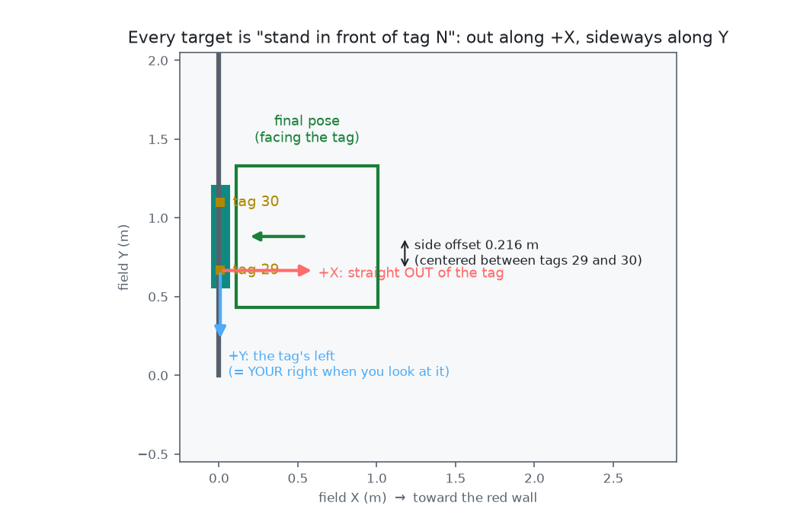
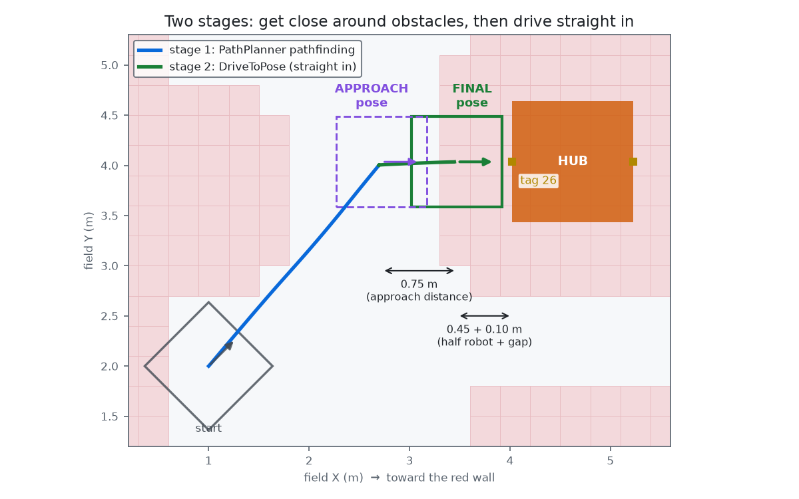
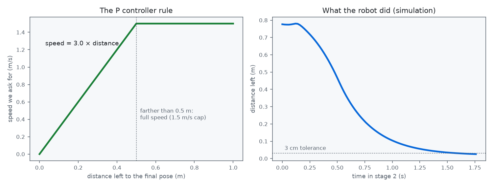
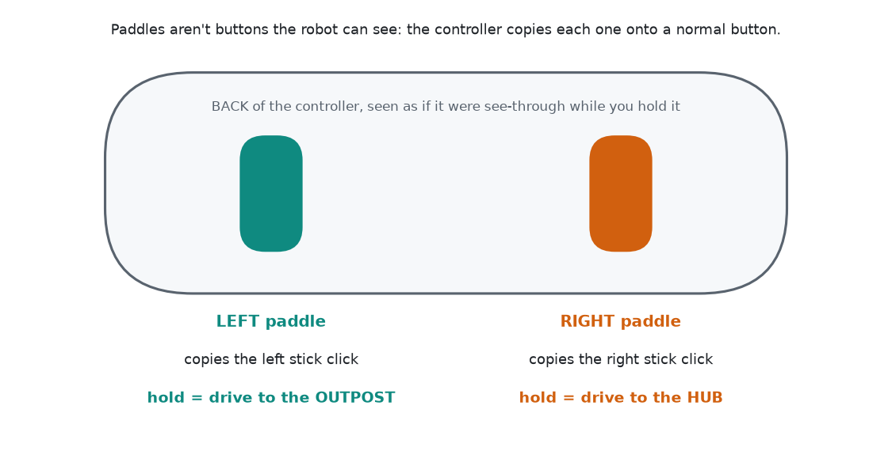

# Auto-Align: hold a button, the robot drives itself to the spot

**Who this is for:** any student on the team. You should know what a subsystem and a command are
(STUDENT-GUIDE.md section 3). No other experience needed.

**What you'll learn:** how a robot knows where it is on the field, how it works out where to go from an AprilTag,
how PathPlanner finds a path around obstacles, and how a P controller parks the robot within a couple of centimeters.

**Code:** `commands/AutoAlign.java`, `commands/DriveToPose.java`, and the `AlignConstants` section in `Constants.java`.
Every line is commented. Read this guide first, then read the code with it open next to you.

---

## 1. Why we're building this

In 2025 (Reefscape), the best teams had a button that lined the robot up on a reef pole by itself. Lining up is
the slowest, most error-prone part of a pick-and-place game: the driver has to get within a couple of centimeters
while being pushed around, looking across the field. A computer does that better and the same way every time.

We think 2027 will be a pick-and-place game too. So we're building it now on our 2026 robot and our half field,
with two spots: the **hub** and the **outpost**. The code doesn't care what the spots are. Next year we change a
few tag numbers and it drives to the new game's spots.

**Controls:**
| Hold | Robot drives to |
|---|---|
| **Left paddle** (= left stick click) | The **outpost** |
| **Right paddle** (= right stick click) | The closest reachable **hub** face |

Let go of the paddle or move a stick, and you're driving again instantly.
**One short buzz** = arrived. **One long buzz** = it gave up (the dashboard `Align/State` says why).

---

## 2. The big idea in three questions

1. **Where am I?** The robot's *pose*: X, Y on the field and which way it's facing.
2. **Where do I want to be?** The *target pose*, worked out from an AprilTag.
3. **How do I get there without hitting anything?** Two stages: PathPlanner for the long, twisty part, then a
   simple controller for the short, exact part.

The rest of this guide is one section per question.

<picture>
  <source media="(prefers-color-scheme: dark)" srcset="docs/images/field-paths-dark.png">
  
</picture>

*The blue lines are the real code running in simulation from four starting spots (A-D). Notice the paths bend
around the shaded squares: those are obstacles PathPlanner knows about.*

---

## 3. Where am I? (the pose)

The field has its own coordinates, like a graph in math class:
- **(0, 0)** is the blue alliance's right-hand corner. **+X** goes toward the red wall. **+Y** goes to the blue drivers' left.
- Distances are in **meters**. Heading 0° faces +X (toward red), and angles go **counter-clockwise**.
- The same coordinates are used **no matter which alliance we're on**. Red stuff just has bigger X numbers.

The robot keeps track of its pose two ways, combined by the drivetrain's **pose estimator**:
- **Odometry:** the wheels and gyro (Pigeon) say how far and which way we've moved. Smooth and fast, but it slowly
  drifts (wheels slip, robots push us).
- **Vision:** the Limelight sees AprilTags. Every tag's exact position on the field is published by FIRST, so seeing a tag
  tells us where we are. This pulls the drift back (`Vision.java`, MegaTag2).

> **Rule #1 of auto-align: it can only drive to the right place if it knows where it is.**
> That's why AutoAlign refuses to start if no tag has been seen in the last 2 seconds (`kMaxSecondsSinceTag`).
> If the pose is wrong, the robot confidently drives to the wrong place.

---

## 4. Where do I want to be? (target from an AprilTag)

Instead of typing in field coordinates by hand, every target is described as
**"stand in front of tag N, this far out, this far to the side."** WPILib has the official position of every tag
(`AprilTagFieldLayout`), so the code looks it up.

A tag's pose has its own little arrows:
- **+X points straight OUT of the tag's face**, into the field.
- **+Y points to the tag's left**, which is *your right* when you stand in front of it looking at it.

<picture>
  <source media="(prefers-color-scheme: dark)" srcset="docs/images/tag-frame-dark.png">
  
</picture>

So the final pose is:
1. Start at the tag.
2. Go **out** along its +X by *half our robot length + a small gap* (0.45 m + 0.10 m). That puts our bumper 10 cm from the tag.
3. Slide **sideways** by the side offset (the outpost opening is between tags 29 and 30, so we slide 0.216 m).
4. **Turn around** 180° so our front faces the tag.

In code (`AutoAlign.targetPose`) that's one line:
```java
tagPose.toPose2d().transformBy(new Transform2d(outM, -sideOffsetM, Rotation2d.k180deg));
```
`transformBy` means "starting from this pose, move this much in *its own* directions". That's why it works for a tag
facing any way, on either alliance, with no if-statements.

**Groups and "closest":** the hub button has *two* possible targets (the hub face toward our wall, tag 26, and the face
toward the middle, tag 20). When you press the button, the code picks whichever is closer. The other two faces are
blocked by the bumps. Each alliance has its own list, so on red the same button goes to the red hub (tags 10 and 4).
This is how 2025 teams picked the nearest reef face.

**The approach pose** is the same thing, 0.75 m farther out (`kApproachDistanceM`). You'll see why next.

---

## 5. How do I get there? Two stages

<picture>
  <source media="(prefers-color-scheme: dark)" srcset="docs/images/two-stages-dark.png">
  
</picture>

### Stage 1: PathPlanner pathfinding (the long, twisty part)

You already know PathPlanner for autos, where *you* draw the path. **Pathfinding** is PathPlanner drawing the path
*itself*, live, from wherever the robot is:
```java
AutoBuilder.pathfindToPose(approachPose, constraints, 0.0);   // 0.0 = arrive stopped
```

How does it know what to avoid? The **navgrid**: `src/main/deploy/pathplanner/navgrid.json`. It chops the field into
30 cm squares, and each square is either *open* or *blocked* (the shaded squares in the pictures). PathPlanner searches
for the shortest route through open squares (with a version of the **A\*** "A-star" search algorithm), smooths it into a curve, and
follows it. Blocked squares are drawn bigger than the real objects so our bumpers clear them.

To change what's blocked: open the PathPlanner app on this project → the **Navigation Grid** editor → click squares
→ save. Deploy, and the robot uses the new grid.

**Why not pathfind all the way to the final spot?** Look at the picture: the final pose is *inside* the shaded area
around the hub (we want to be right up against it!). The pathfinder won't go into blocked squares. Also, a pathfinder
might arrive from a diagonal and clip the corner. So it stops at the approach pose, out in the open, lined up straight.

### Stage 2: DriveToPose (the short, exact part)

From the approach pose we drive **straight in** with our own small command, `DriveToPose`. Every 20 ms it does:

1. **Error** = arrow from where we are to where we want to be.
2. **Speed = kP × distance left**, capped at a max. This is a **P controller** (the P in PID: *proportional*).
3. Drive along the error arrow at that speed. Do the same for turning: turn rate = kP × degrees off.
4. Finished when we've been within **3 cm and 2°** for 0.15 s.

<picture>
  <source media="(prefers-color-scheme: dark)" srcset="docs/images/p-controller-dark.png">
  
</picture>

Far away → fast. Close → slow. There → stopped. That's why the right-hand graph curves down smoothly instead of
slamming into the spot. Two extras keep it gentle: speed can only grow by `kFinalMaxAccel` per second (so the wheels
don't slip when it starts), and the top speed is capped at 1.5 m/s.

If we're already within 1 m of the target **and lined up straight in front of it** when the button is pressed, stage 1
is skipped (`kSkipPathfindingDistanceM`, `kMaxSidewaysToSkipPathfindingM`): there's nothing to path around, so just
drive straight in. If we're close but off to the side, we still pathfind, because a straight line could clip the
corner of the hub.

### Putting it together: a command sequence
```java
Commands.sequence(
        start,             // reset the safety checks
        pathfind,          // stage 1 (or Commands.none() if we're already close)
        finalApproachStart,
        new DriveToPose(drivetrain, goal))      // stage 2
    .until(this::shouldStopEarly)              // safety checks, every loop
    .finallyDo(interrupted -> finish(...));    // buzz + dashboard + log
```
It's wrapped in `Commands.defer(...)`, which means *the plan is made when you press the button*, using where the
robot is at that moment. Without `defer`, it would be planned once when the robot boots, before we knew where we'd be.

---

## 6. Avoiding things: what it can and can't do

| Obstacle | Handled? | How |
|---|---|---|
| **Field elements** (hub, bumps, walls, structures) | ✅ Yes | The navgrid. They never move, so we mark them once. |
| **Game pieces** on the floor | ❌ No | The robot doesn't know they're there. Driver watches. |
| **Other robots** | ❌ No | Same. PathPlanner *can* avoid moving obstacles (`Pathfinding.setDynamicObstacles`) if you tell it where they are, but that needs a camera that detects robots. That's a project for later (see Challenge 7). |

Because it can't see robots, **the driver is always the safety system**, backed up by these checks
(`AutoAlign.shouldStopEarly`):

| Safety layer | What happens |
|---|---|
| **Hold to run** | Let go of the paddle: it stops immediately. (`whileTrue`) |
| **Stick override** | Move a drive stick past 20%: cancels, you're driving. (`kDriverOverrideStick`) |
| **Position check** | Won't start without a recent AprilTag sighting. (`kMaxSecondsSinceTag`) |
| **Stuck check** | Wheels told to go > 0.5 m/s but turning < 0.1 m/s for 0.5 s = we hit something. Gives up + long buzz. |
| **Timeout** | The final approach takes more than 3 s = something's in the way. Gives up + long buzz. |
| **Startup check** | PathPlanner does a practice run at boot. Pressing during it gets a "try again" buzz instead of a stuck robot. |

> **Bug we found while building this:** pressing the button while PathPlanner's boot-time practice run was still going
> made the robot sit forever in "Pathfinding". We only found it by testing in simulation. That's why the startup check
> exists. **Test in simulation first.**

---

## 7. Map of the code

| File | What it does |
|---|---|
| `Constants.java` → `AlignConstants` | Every number: which tags, distances, speeds, tolerances, safety limits. **Start here.** |
| `commands/AutoAlign.java` | The plan: check → pick closest → work out poses → stage 1 + stage 2 → safety checks → buzz. |
| `commands/DriveToPose.java` | Stage 2: the P controller that drives straight to an exact pose. |
| `RobotContainer.java` | Binds the stick clicks (paddles), the stick-override check, and the controller buzz. |
| `deploy/pathplanner/navgrid.json` | The obstacle map. Edit it in the PathPlanner app. |

**Dashboard (Elastic / AdvantageScope):**
- `Align/State`: Idle, Pathfinding, Final approach, Arrived, Cancelled, Gave up / Can't align + *why*
- `Align/Target`: which spot and tag it picked
- `Align/Distance left (m)` and `Align/Heading error (deg)`: graph these while tuning
- AdvantageScope 2D field: add `DriveState/Pose` (robot), `Poses/Align/Goal`, `Poses/Align/Approach`, and
  `Poses/Auto path` (the path PathPlanner planned)

---

## 8. Set up the paddles

The paddles under an Xbox Elite (or similar) controller are **not buttons the robot can see**. The controller has
the same 10 buttons as a normal Xbox controller. A paddle just **copies** one of them. So we tell the controller
which buttons to copy:

<picture>
  <source media="(prefers-color-scheme: dark)" srcset="docs/images/paddles-dark.png">
  
</picture>

**Xbox Elite Series 2:** on the driver station laptop, install the **Xbox Accessories** app (Microsoft Store) → plug
in the controller → **Configure** → make a new profile (e.g. "FRC") → set the paddles you want:
**left paddle → Left stick click**, **right paddle → Right stick click**. Set any other paddles to *Unmapped*.
Save it to one of the controller's onboard slots, and on the controller press the profile button until that slot's light is on.
The profile is stored *on the controller*, so it works on any laptop.

**Other paddle controllers** (PowerA, Turtle Beach, 8BitDo...): usually hold a *program* button, press the paddle,
then press the button it should copy. Check its manual.

**Check it worked:** Driver Station → **USB** tab → press each paddle and watch the button lights.
Left stick click is button **9**, right stick click is button **10**. If a paddle lights up anything else, fix the mapping:
it would run a different command.

**Why stick clicks?** They're the two buttons nobody uses on purpose. And if a driver clicks a stick by accident
while driving, the stick is moving, so AutoAlign quietly does nothing.

---

## 9. Try it in simulation (do this first!)

1. Plug an Xbox controller into your laptop.
2. VS Code: `Ctrl+Shift+P` → **WPILib: Simulate Robot Code** → *Sim GUI*.
3. In the Sim GUI: drag your controller into **Joystick 0**. Set **Alliance Station** to Blue 1. Click **Teleoperated**.
4. Open AdvantageScope → connect to the simulator → 2D field, add the poses listed in section 7.
5. Drive somewhere, then **hold the right stick click**. Watch the planned path appear and the robot follow it.
6. Try the left stick click. Try moving a stick halfway (it should cancel). Try from behind the hub.

Simulation has no camera, so the "has it seen a tag" check is skipped there. Everything else is the real code.

---

## 10. Try it on the robot (half field)

**Before you start:**
- The Limelight's **field map** must be the 2026 one, and the same version as `kFieldLayout` in Constants (welded or AndyMark).
- Our half-field elements must be at their **real field positions** relative to each other (see MENTOR-NOTES.md).
- Driver Station **alliance color = the half we built** (the code picks *our* alliance's hub/outpost).
- A clear area, everyone off the field, and someone at the laptop ready to disable (**Enter** = disable, **Space** = emergency stop).

**Step by step:**
1. **Check the pose first.** Drive around with the AdvantageScope field open. Does the robot on screen match where the
   real robot is? Put it against the hub and measure. If it's off, fix vision (camera mount numbers) before anything else.
2. **Slow it down** for the first runs: in `AlignConstants` set `kPathfindMaxSpeed = 1.0` and `kFinalMaxSpeed = 0.5`. Deploy.
3. **Stage 2 only:** park about 0.7 m straight out from a hub face, hold the right paddle. It should creep in and buzz once.
   Measure the bumper gap (should be ~10 cm) and whether it's centered.
4. **Stage 1 + 2:** start 3-4 m away, hold the paddle. Let go halfway once to see it stop.
5. **Outpost:** same thing with the left paddle.
6. **Safety tests:** move a stick mid-run (cancels). Put a tote in the path at low speed (stuck check: long buzz).
7. Bring the speeds back up a step at a time.

---

## 11. Tuning: symptom → fix

| What you see | Likely cause | Change |
|---|---|---|
| Stops short / too far from the tag | Gap or robot size | `kBumperGapM`, `kRobotHalfLengthM` |
| Always off to one side by the same amount | Camera mount numbers, or the target needs a side offset | Camera pose in `VisionConstants`, then `sideOffsetM` |
| Off by a different amount each time | Pose is wrong / jumpy | Vision first: check `Vision/.../Correction (m)` |
| Creeps the last few cm very slowly | P too low | Raise `kFinalTranslationP` (try 4) |
| Overshoots and wiggles back | P too high or too fast | Lower `kFinalTranslationP` or `kFinalMaxSpeed` |
| Never says "Arrived" | Tolerance tighter than the robot can do | Loosen `kPositionToleranceM` / `kHeadingToleranceDeg` |
| Path cuts too close to something | Navgrid doesn't block enough | Block more squares in the PathPlanner navgrid editor |
| "Gave up: stuck" with nothing in the way | Stuck check too sensitive | Raise `kStallSeconds` |

Change **one** thing at a time, and write down what you changed and what happened.

---

## 12. Next year: point it at the new game

1. `kFieldLayout` → the 2027 field (WPILib adds it in the 2027 release). Load the same map on the Limelight.
2. Replace `kHub` / `kOutpost` with the new game's spots: tag IDs + side offsets. A scoring spot left and right of a
   tag (like 2025's reef poles) = two `FieldTarget`s with side offsets of `+x` and `-x`.
3. New navgrid: PathPlanner ships a default one for each new game. Check it, adjust it.
4. `kFaceTargetWithFront`: which side of the new robot scores?
5. `kRobotHalfLengthM`: the new robot's size with bumpers.
6. Bind each group to a button in `RobotContainer`.

That's it: AutoAlign and DriveToPose don't change.

---

## 13. Challenges

Do these in simulation. Answers are in MENTOR-NOTES.md, but try first!

1. **By hand:** tag 26 is at X = 4.022, Y = 4.035, facing 180°. Work out the final pose (X, Y, heading) the robot drives to. Check your answer on the AdvantageScope field.
2. **Back up to it:** make the robot face the outpost with its *back*. Which one constant? What happens to the heading?
3. **New button:** add a **tower** target (blue tags 31 + 32, red tags 15 + 16, centered between them like the outpost) on the **A** button.
4. **Reef-style:** make the hub button pick a spot 0.3 m to the *left* of center and a new button for 0.3 m to the *right*.
5. **Feel the P:** set `kFinalTranslationP` to 1, then 10. Graph `Align/Distance left (m)`. What changes, and why?
6. **Fake obstacle:** in the navgrid editor, block a 1 m square in the middle of the alliance zone. Run the sim from the other side. Does the path go around it?
7. **Think:** how could the robot avoid *other robots*? What sensor would you need, and where would you put its output in the code?
8. **Think:** why do we skip stage 1 when we're within 1 m and lined up? What could go wrong if we didn't? And why does it also check that we're *lined up*, not just close?

---

## Words

| Word | Meaning |
|---|---|
| **Pose** | Position (X, Y) + heading. `Pose2d` in code. |
| **Odometry** | Working out the pose from wheel motion + gyro. |
| **Pose estimator** | Blends odometry and vision into one best-guess pose. |
| **AprilTag** | The square black-and-white markers on the field. Each has a known ID and position. |
| **Field layout** | The list of where every tag is (`AprilTagFieldLayout`). |
| **Transform** | "Move this much forward/sideways and turn this much, in my own directions." |
| **Pathfinding** | The computer drawing a path around obstacles by itself. |
| **Navgrid** | The open/blocked squares map pathfinding uses. |
| **A\*** | The search algorithm that finds the shortest route through the grid. |
| **P controller** | Output = kP × error. The simplest feedback controller (the P in PID). |
| **Tolerance** | How close counts as "there". |
| **Debounce** | Something has to stay true for a while before we believe it. |
| **`defer`** | Build the command when it starts, not when the code boots. |
